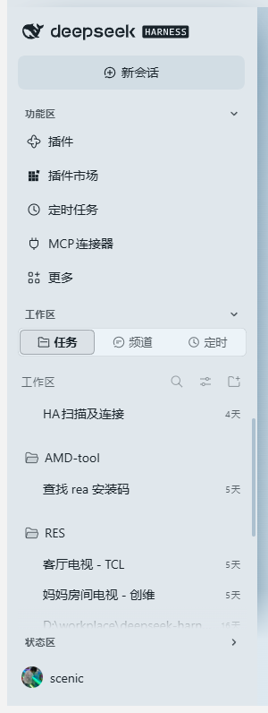
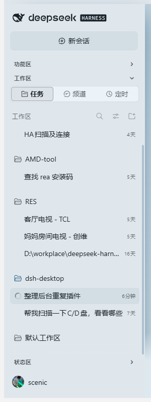
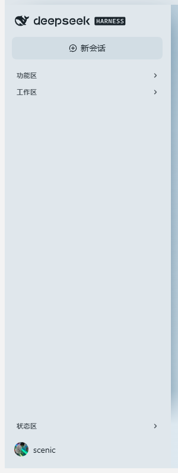

# dsh-sidebar-sections

Collapsible section headers for the [DeepSeek Harness](https://github.com/deepseek-ai/deepseek-harness) sidebar.

[English](#english) · [简体中文](#简体中文)

<table>
  <tr>
    <td align="center"><br><sub>All sections open</sub></td>
    <td align="center"><br><sub>Workspace only</sub></td>
    <td align="center"><br><sub>All folded — account row pinned to the bottom</sub></td>
  </tr>
</table>

---

## 简体中文

DSH 侧栏里的东西一多，整列就变得又长又挤。这个插件给侧栏加上三根可折叠的标题条，哪些区块常驻、哪些区块收起，由你自己定。

### 三段分别控制

| 折叠条 | 管的是 | 内容 |
| --- | --- | --- |
| **功能区** | `nav._panelList`，以及「新会话」按钮到工作区之间的东西 | 插件、插件市场、定时任务、MCP 连接器、更多 |
| **工作区** | 工作区区域 `div._regionArea` | 任务 / 频道 / 定时 三个 tab，以及工作区与会话列表 |
| **状态区** | `div._footArea` 里**除设置区以外的一切** | Remote 卡片、OpenCode GO 用量卡片，以及以后任何东西 |

三段互相独立。想只留工作区？把另外两根收起来就行 —— 这也正是默认状态。

### 新加的东西会自动归位

不按 class 名单点名，而是**按位置**判定：

- 外壳里排在「新会话」之后、工作区之前的 → 功能区；
- 外壳里排在工作区之后的（`.panelList` 之外的全部兄弟节点）→ 状态区；
- `_footArea` 里的每个子元素 → 状态区，唯一的例外是设置区本身，以及任何**包含**设置区的容器（这样账号那排不会被一起藏掉）。

所以宿主以后往侧栏底部加个入口、或者别的插件（例如用量卡片）自己 `insertBefore` 塞一张卡，都会被当次重扫描收进状态区，不需要给本插件升级。

### 账号与设置永远钉在最底部

底部那一排（呼叫按钮、账号头像 `scenic`）**不跟着状态区一起折叠**，位置也不随任何折叠状态浮动，始终贴在侧栏最下面。

### 装上就能用

```sh
dsh plugin --profile web add "https://github.com/LeeScenic/dsh-sidebar-sections/releases/latest/download/dsh-sidebar-sections-1.0.5.tgz"
```

桌面版把 `web` 换成 `desktop`：

```sh
dsh plugin --profile desktop add "https://github.com/LeeScenic/dsh-sidebar-sections/releases/latest/download/dsh-sidebar-sections-1.0.5.tgz"
```

也可以直接从仓库装：`dsh plugin --profile desktop add "github:LeeScenic/dsh-sidebar-sections#v1.0.5"`。

装完要**完全退出再打开** DSH —— 客户端 bundle 是启动时加载的。

### 几个细节

- **纯客户端增强**：不注册槽位，不动宿主 React 树，只往页面里插 DOM 和一段 `<style>`，卸载后不留残渣。
- **不写死样式哈希**：靠 `[class*="_regionArea"]` 这类后缀匹配加一条 `(^|\s)[A-Za-z0-9_-]*_<suffix>(\s|$)` 精确校验来定位锚点，宿主升级换了 CSS Modules 哈希也照样能用。
- **按位置归位**：给要折叠的元素打 `data-dsh-sc-part="panels|foot"`，每次重扫描都按当前 DOM 重新判定，所以新插进来的卡片当次就被收进状态区。
- **外壳靠最低公共祖先找**：外壳 = `_regionArea` 与 `_footArea` 的最低公共祖先，而不是「区块的父节点」。0.2.2 起宿主把 `nav._panelList` 和 `_regionArea` 一起收进了 `scrollRegion > scrollArea` 滚动容器（`data-sidebar-scrollport`），旧写法会把这层包裹当成外壳，新旧布局现在共用一条规则。
- **折叠状态扛得住重渲染**：折叠是 `<html>` 上的 `data-dsh-sc-<key>` 属性加一条 `!important` 规则，React 重绘不会把藏起来的区块弄回来。
- **标题条会自己补回**：`MutationObserver`（rAF 去抖）加 1500 ms 兜底定时器，被重绘冲掉就重新插；同一分区只留一条，旧的错位标题条会被清掉。
- **窄栏自动隐藏**：侧栏收成图标条（`clientWidth < 96`）时标题条自动隐藏，不硬挤成一条竖线。
- **出错不影响侧栏**：整段逻辑包在 try/catch 里，出问题只 `console.warn`。

### 状态记忆

存在 `localStorage["dsh-sidebar-sections:v3"]`，形如 `{"panels":true,"region":false,"foot":true}`（`true` = 折叠）。

已知限制：DSH 桌面版每次启动换一个端口，等于换了 origin，上一次的状态读不回来，于是回到默认值。默认值本来就是「只留工作区」，所以实际影响很小。

### 兼容性

DSH `0.2.1-rc.3` 起，web 与 desktop 都行；`0.2.1-rc.3` 与 `0.2.2-rc.2`（新的滚动容器布局）都已实测。

> 1.0.4 及以前声明了 `engines.dsh: "0.2.1-rc.3 || 0.2.1-rc.4 || 0.2.1-rc.5"`。DSH 0.2.2 把 `engines.dsh` 当作硬门禁：不满足就跳过整个 bundle（记进 `skippedBundles`），插件于是静默失效。1.0.5 起去掉了这个字段——插件只做 DOM 增强、找不到锚点就安静地什么都不做，用版本号挡人只会让用户遇到「升级后突然没了」。

### 文件

| 文件 | 作用 |
| --- | --- |
| `lib/client.js` | 浏览器半边 —— 全部行为 |
| `lib/index.js` | host 半边 —— 空的 `apply()`，只为让入口出现在 Loader 图里 |
| `cordis.patch.yml` | bundle patch，insert 一行（纯新增，带重复挂载守卫） |
| `dsh.plugin.json` | 插件清单 |
| `docs/screenshots/` | 上面那三张截图 |

MIT License.

---

## English

### What it does

The sidebar is cut into three labelled rows — **Panels**, **Workspace** and **Status** — and each one
folds with a single click.

| Section | Host element | What it holds |
| --- | --- | --- |
| Panels | `nav._panelList`, plus everything between the new-session button and the workspace area | Plugins / Plugin Market / Scheduled tasks / MCP connectors / More |
| Workspace | `div._regionArea` | the Tasks / Channels / Scheduled tabs and the session + workspace list |
| Status | everything inside `div._footArea` **except the settings row** | Remote entry, OpenCode GO usage, and whatever comes next |

The three are independent. The default is *Workspace only*: open the app and the workspace list is the
only thing expanded.

Nothing is named in a fixed class list — sections are decided **by position**:

- at shell level, everything after the new-session button and before the workspace area → Panels;
- at shell level, everything after the workspace area (the panel list aside) → Status;
- every child of `_footArea` → Status, with one exception: the settings row itself, and any container
  that *contains* it (so the account row is never hidden).

So a footer entry the host adds later, or a card another plugin `insertBefore`s into the footer, is
folded into Status on the next rescan — no update of this plugin required.

The settings row (`div._settingsArea`: the call button and your account avatar) is **never** folded and
is pinned to the very bottom of the sidebar, so it does not move when sections open or close.

### Install

```sh
dsh plugin --profile web add "https://github.com/LeeScenic/dsh-sidebar-sections/releases/latest/download/dsh-sidebar-sections-1.0.5.tgz"
```

Desktop profile: `dsh plugin --profile desktop add "https://github.com/LeeScenic/dsh-sidebar-sections/releases/latest/download/dsh-sidebar-sections-1.0.5.tgz"`,
or straight from the repo: `dsh plugin --profile desktop add "github:LeeScenic/dsh-sidebar-sections#v1.0.5"`.

Fully quit and reopen DSH after installing — client bundles are loaded at start-up.

### How it works

Client-only plugin (`dsh.client.platform = "web"`). It registers no slot and does not touch the React
tree:

1. Sections are located by CSS Modules **class suffix** (`[class*="_regionArea"]` plus an exact
   `(^|\s)[A-Za-z0-9_-]*_<suffix>(\s|$)` test), never by the build hash — a host upgrade that changes
   the hash keeps working.
2. The shell is the **lowest common ancestor** of `_regionArea` and `_footArea`, not "the parent of the
   block": since 0.2.2 the host nests `nav._panelList` and `_regionArea` inside a
   `scrollRegion > scrollArea` wrapper (`data-sidebar-scrollport`), so one rule covers both layouts.
3. Fold candidates get `data-dsh-sc-part="panels|foot"` and are re-classified from the live DOM on
   every rescan, so a node inserted later is folded the same tick it appears.
4. Folding is a `data-dsh-sc-<key>` attribute on `<html>` plus one `!important` CSS rule, so a React
   re-render cannot restore a hidden section.
5. The header rows can themselves be dropped by a re-render, so a `MutationObserver` (rAF-debounced)
   plus a 1500 ms safety timer puts them back; a section keeps exactly one header row, stale ones are
   removed.
6. In the collapsed rail (`clientWidth < 96`) the header rows hide themselves instead of squeezing
   into a vertical stack, and the icon strip is never folded.
7. Everything is wrapped in try/catch: a failure only `console.warn`s and never breaks the sidebar.

### State

Stored in `localStorage["dsh-sidebar-sections:v3"]`, e.g. `{"panels":true,"region":false,"foot":true}`
(`true` = folded).

Known limitation: the DSH desktop app picks a new port on every start, so the origin changes and the
previous state cannot be read back — the defaults apply again. The defaults *are* "workspace only",
so the practical effect is small.

### Compatibility

DSH `0.2.1-rc.3` and later, web and desktop; both `0.2.1-rc.3` and `0.2.2-rc.2` (the new scrolling
shell) have been tested. Requires nothing from the host beyond the sidebar's CSS Modules class names,
which are matched by suffix.

> Up to 1.0.4 `package.json` declared `engines.dsh: "0.2.1-rc.3 || 0.2.1-rc.4 || 0.2.1-rc.5"`. DSH
> 0.2.2 treats `engines.dsh` as a **hard gate**: if it is not satisfied the whole bundle is skipped
> (recorded in `skippedBundles`) and the plugin silently stops working. 1.0.5 no longer declares the
> field — this is a DOM-only enhancement that quietly does nothing when the anchors are missing, and
> gating on a version number only produces "it vanished after the upgrade".

### Files

| File | Purpose |
| --- | --- |
| `lib/client.js` | browser half — all of the behaviour |
| `lib/index.js` | host half — empty `apply()`, only so the entry shows up in the Loader graph |
| `cordis.patch.yml` | bundle patch, inserts the plugin row (pure addition, with a double-mount guard) |
| `dsh.plugin.json` | plugin manifest |
| `docs/screenshots/` | the three screenshots above |

### License

MIT
