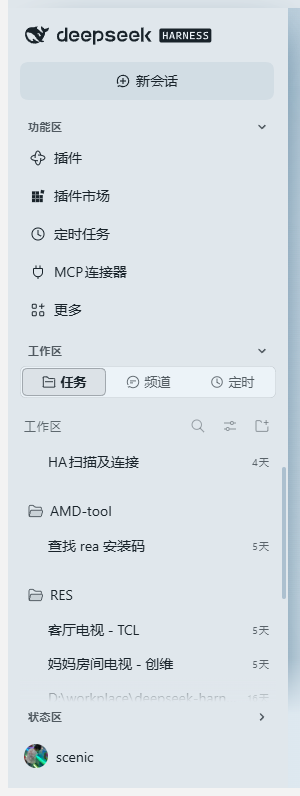
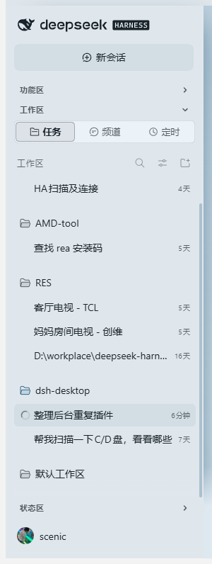
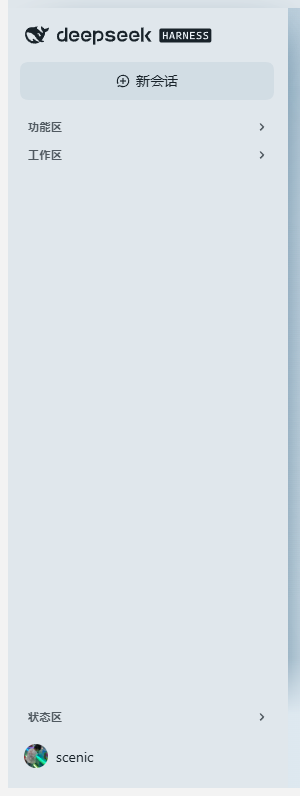

# dsh-sidebar-sections

[English](README.md) · **简体中文**

给 [DeepSeek Harness](https://github.com/deepseek-ai/deepseek-harness) 左侧栏加可折叠的分区标题条：把侧栏切成 **功能区 / 工作区 / 状态区** 三段，每段点一下收起、再点展开。

<table>
  <tr>
    <td align="center"><br><sub>三段都展开</sub></td>
    <td align="center"><br><sub>只留工作区</sub></td>
    <td align="center"><br><sub>全部收起，账号那排钉在最底部</sub></td>
  </tr>
</table>

| 分区 | 宿主元素 | 里面是什么 |
| --- | --- | --- |
| 功能区 | `nav._panelList` 以及「新会话」按钮到工作区之间的东西 | 插件 / 插件市场 / 定时任务 / MCP 连接器 / 更多 |
| 工作区 | `div._regionArea` | `任务 / 频道 / 定时` 标签行 + 会话与工作区列表 |
| 状态区 | `div._footArea` 里**除设置区以外的一切** | Remote 入口、用量卡片，以及以后任何东西 |

默认就是「只展开工作区」——打开就是干净的一屏。

设置区（`div._settingsArea`：呼叫按钮 + 账号头像）**永不参与折叠**，并且钉死在侧栏最底部，不随任何分区的开合上下移动。

## 新加的东西会自动归位

不按 class 名单点名，而是**按位置**判定：

- 外壳里排在「新会话」之后、工作区之前的 → 功能区；
- 外壳里排在工作区之后的（`.panelList` 之外的全部兄弟节点）→ 状态区；
- `_footArea` 里的每个子元素 → 状态区，唯一的例外是设置区本身，以及任何**包含**设置区的容器（这样账号那排不会被一起藏掉）。

所以宿主以后往侧栏底部加个入口、或者别的插件（例如用量卡片）自己 `insertBefore` 塞一张卡，都会被当次重渲染后的扫描收进状态区，不需要给本插件升级。

## 安装

```sh
dsh plugin --profile web add "https://github.com/LeeScenic/dsh-sidebar-sections/releases/latest/download/dsh-sidebar-sections-1.0.5.tgz"
```

桌面版：`dsh plugin --profile desktop add "https://github.com/LeeScenic/dsh-sidebar-sections/releases/latest/download/dsh-sidebar-sections-1.0.5.tgz"`。

也可以直接从仓库装：`dsh plugin --profile desktop add "github:LeeScenic/dsh-sidebar-sections#v1.0.5"`。

装完要**完全退出 DSH 再打开**——客户端 bundle 在启动时加载。

## 实现方式

纯浏览器半边插件（`dsh.client.platform = "web"`），不注册 slot、不改 React 树：

1. 用 CSS Modules 的 **class 后缀**定位锚点（`_regionArea` / `_footArea` / `_panelList` / `_newSession` / `_settingsArea`），正则 `(^|\s)[A-Za-z0-9_-]*_<后缀>(\s|$)` 精确匹配，不写死构建哈希——宿主升级换了哈希也照样能找到。
2. 外壳取 `_regionArea` 与 `_footArea` 的**最低公共祖先**，不假设「区块的父节点就是外壳」：0.2.2 起宿主把 `nav._panelList` 与 `_regionArea` 收进了 `scrollRegion > scrollArea` 滚动容器（`data-sidebar-scrollport`），两者不再直接挂在外壳上，这条规则同时兼容新旧两种嵌套。
3. 给每块要折叠的元素打上 `data-dsh-sc-part="panels|foot"`，折叠靠 `<html>` 上的 `data-dsh-sc-<key>` 属性 + 一行 `!important` 的 CSS，React 重渲染冲不掉隐藏状态；每次扫描按当前 DOM 重新归位，所以新出现的节点当次就被打上标记。
4. 标题条自己可能在重渲染里被丢掉，所以 `MutationObserver`（childList + subtree，rAF 去抖）+ 1500ms 兜底定时器会把它补回去；同一个分区只保留一条标题条，位置变了的旧条会被清掉。
5. 整栏折叠成窄条时（外壳 `clientWidth < 96`，对应宿主的 `data-sidebar-collapsed` 形态）标题条自动隐藏，功能区的图标栏也不会跟着被折叠，避免挤成一列竖字或空栏。
6. 全程 try/catch：任何一次失败只 `console.warn`，绝不影响侧栏本身。

## 状态

存在 `localStorage["dsh-sidebar-sections:v3"]`，形如 `{"panels":true,"region":false,"foot":true}`（`true` = 折叠）。

已知限制：DSH 桌面版每次启动换端口 → origin 变了 → 读不到上一次的记录，回到默认值。默认值本来就是「只展开工作区」，所以影响不大。

## 兼容性

DSH `0.2.1-rc.3` 起，网页版与桌面版均可；`0.2.1-rc.3` 与 `0.2.2-rc.2`（新滚动容器布局）都已实测。

> 1.0.4 及以前在 `package.json` 里声明了 `engines.dsh: "0.2.1-rc.3 || 0.2.1-rc.4 || 0.2.1-rc.5"`。DSH 0.2.2 把 `engines.dsh` 当成**硬门禁**：不满足就跳过整个 bundle（记进 `skippedBundles`），于是插件静默失效。1.0.5 起不再声明该字段——本插件只做 DOM 增强、找不到锚点就安静地什么都不做，用版本号把人挡在外面只会变成「升级后突然没了」。

## 文件

| 文件 | 作用 |
| --- | --- |
| `lib/client.js` | 浏览器半边，全部行为 |
| `lib/index.js` | host 半边，空 `apply()`，只为让条目出现在 Loader 图里 |
| `cordis.patch.yml` | bundle patch，insert 一行（纯新增，自带重复挂载守卫） |
| `dsh.plugin.json` | 插件清单 |
| `docs/screenshots/` | 上面那三张截图 |

## License

MIT
